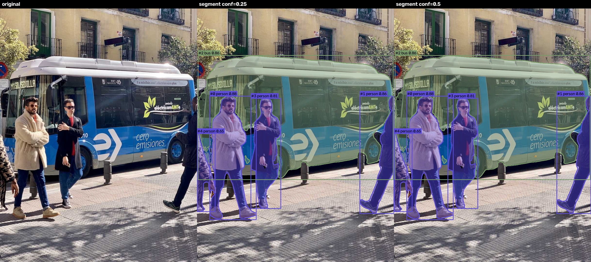
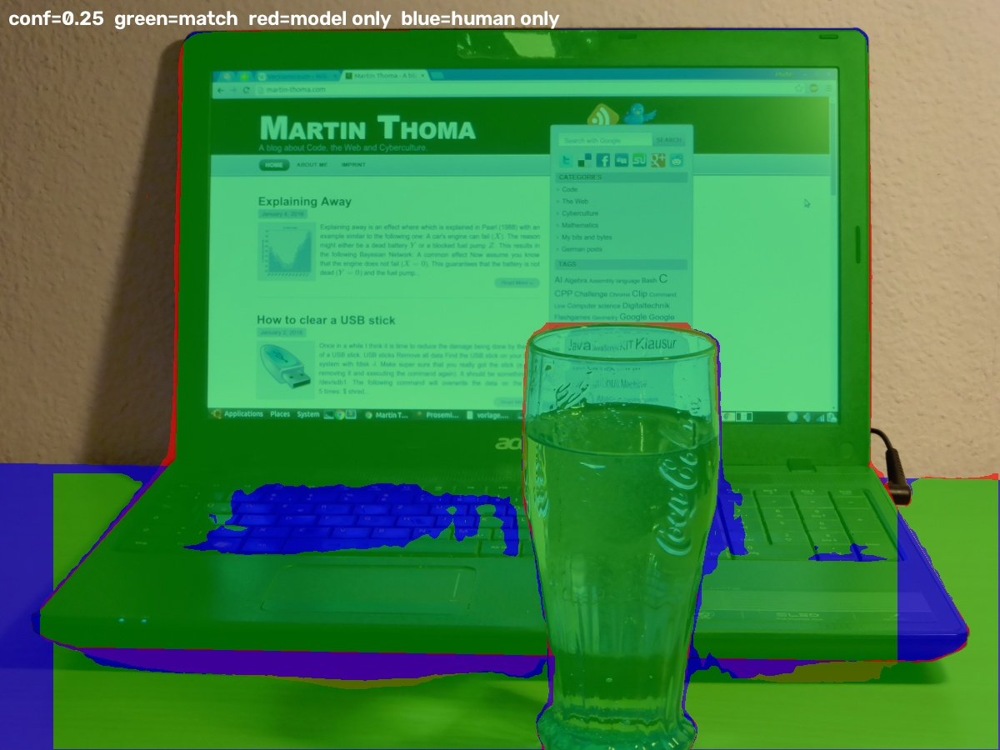
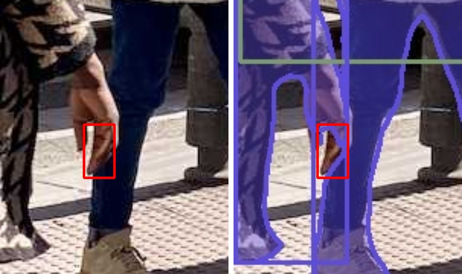
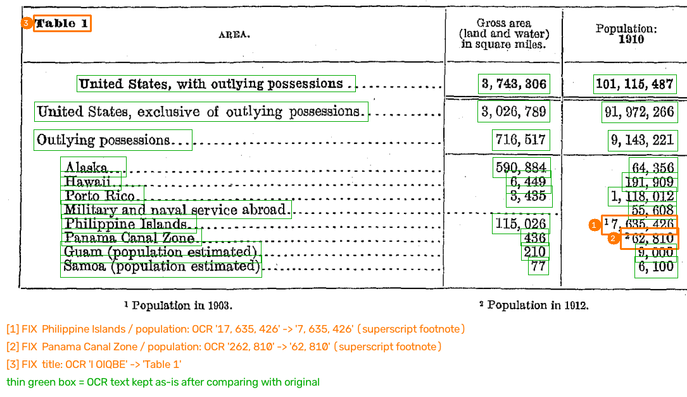

# AI가 이미지를 읽기 — 선택 과제 A · B

교재 「AI가 이미지를 읽기」 05 실습의 선택 과제 **A(YOLO 서비스)** 와 **B(OCR 표 문서화)** 를 모두 수행한 저장소입니다.
코딩 에이전트(Claude Code)와 함께 만들었고, 결과는 모두 `outputs/` 아래 파일로 저장됩니다.

| 과제 | 한 줄 요약 | 바로 볼 파일 |
|---|---|---|
| A | 사진 → 박스(yolo26n.pt) + 마스크(yolo26n-seg.pt), conf 0.25/0.50 비교, 사람이 칠한 정답 마스크와 픽셀 대조 | [비교 이미지](outputs/yolo/bus/compare_segment_conf.jpg) · [화면 캡처](outputs/yolo/screenshots/) · [manifest](outputs/yolo/manifest.json) |
| B | Census 1910 Table 1 이미지 → OCR → 표 복원(CSV/Markdown), 합계 검사로 오류 3건 발견·수정 | [document.md](outputs/ocr/document.md) · [table.csv](outputs/ocr/table.csv) · [검토 오버레이](outputs/ocr/review_overlay.png) |

평가 기준(실행 가능성 / 원본 대조·근거 / 범위 정직성 / 설명)과 이 README 절의 대응은 [맨 아래 표](#평가-기준-대응표)에 정리했습니다.

---

## 0. 실행 위치와 환경

- **실행 위치:** 로컬 PC — Windows 11, CPU만 사용(GPU 없음), Python 3.12.15 (uv로 만든 가상환경)
- 과제별로 가상환경을 나눴습니다. Ultralytics(torch)와 OCR 패키지는 OpenCV·numpy 버전 요구가 달라 한 환경에 섞으면 충돌 가능성이 있기 때문입니다.

```bash
uv venv .venv-yolo --python 3.12
uv pip install --python .venv-yolo/Scripts/python.exe -r requirements-yolo.txt --extra-index-url https://download.pytorch.org/whl/cpu --index-strategy unsafe-best-match
```

```bash
uv venv .venv-ocr --python 3.12
uv pip install --python .venv-ocr/Scripts/python.exe -r requirements-ocr.txt
```

> **환경 이슈(숨기지 않고 기록):** 이 PC는 Windows **스마트 앱 컨트롤**이 켜져 있어, 서명 평판이 없는 일부 DLL 로드를 막습니다.
> - `paddlepaddle` 의 `libpaddle` DLL → 차단(WinError 4551). **로컬에서 PaddlePaddle 엔진은 실행 불가.**
> - `pandas` DLL → 차단. 그래서 pandas에 의존하는 Gradio 대신 표준 라이브러리 `http.server` 로 웹 화면을 만들었습니다.
> - 보안 설정은 끄지 않았습니다. 대신 B는 **같은 PaddleOCR PP-OCRv5 가중치를 ONNX로 변환해 실행하는 RapidOCR** 로 로컬 실행하고, 원본 PaddleOCR로 돌리는 **Colab 노트북**([ocr/paddleocr_colab.ipynb](ocr/paddleocr_colab.ipynb))을 함께 두었습니다(교재: "로컬이나 Colab 중 실행할 곳을 정합시다"). Colab 노트북은 **2026-11-11 Google Colab(CPU, Python 3.13)에서 전체 실행을 확인**했습니다(B-1 아래 "Colab 실행 확인 결과").

---

## A. YOLO 서비스 만들기

### A-1. 실행 방법 (저장소 루트에서)

| 형태 | 명령 | 결과 |
|---|---|---|
| 배치 실행(저장) | `.venv-yolo\Scripts\python.exe yolo\run_yolo.py` | `outputs/yolo/` 에 이미지·JSON·마스크·manifest·코드 사본 |
| 내 사진 추가 | `.venv-yolo\Scripts\python.exe yolo\run_yolo.py input\bus.jpg input\desk-objects.jpg input\내사진.jpg` | `outputs/yolo/내사진/` |
| 정답 마스크 대조 | `.venv-yolo\Scripts\python.exe yolo\eval_human_mask.py` | `outputs/yolo/desk-objects/human_mask_eval*.{json,jpg}` |
| 웹 화면 | `.venv-yolo\Scripts\python.exe yolo\app.py` → http://127.0.0.1:7860 | 사진 업로드 + 임계값 슬라이더 |
| 노트북 | [yolo/yolo_service.ipynb](yolo/yolo_service.ipynb) (실행 결과 포함 저장) | 원본·박스·마스크·JSON |

가중치(`yolo26n.pt`, `yolo26n-seg.pt`)는 첫 실행 때 `models/` 로 자동 다운로드됩니다(저장소에는 넣지 않음).

> **수정 기록(웹 화면 업로드 버그):** 처음 버전은 업로드한 사진을 `upload.img` 로 저장했습니다. Ultralytics는 **확장자로 이미지 여부를 판단**하므로 `No images or videos found` 오류가 났고, 서버가 응답 없이 끝나 화면에 결과가 나오지 않았습니다. 예제 버튼은 원래 `.jpg` 경로를 써서 정상 동작했기 때문에 처음 테스트에서는 이 문제가 드러나지 않았습니다. 이제는 업로드 바이트를 디코딩해 `.jpg` 로 저장하고, 이미지가 아닌 파일이나 실행 오류는 화면 상태 표시줄에 메시지로 보여 줍니다.

### A-2. 설정과 선택 이유

| 설정 | 값 | 이유 |
|---|---|---|
| 모델 | `yolo26n.pt` / `yolo26n-seg.pt` | 과제 지정. 질문이 "어디에 있나(박스)"와 "윤곽이 어디까지인가(마스크)" 두 가지라 detect·segment 두 모델을 같은 사진에 나란히 돌림. nano 크기라 GPU 없는 CPU에서도 가볍게 실행됨 |
| `imgsz` | 640 | 과제 지정, 모델 학습 해상도. 박스 좌표는 원본 픽셀로 되돌려 저장(`box_xyxy`) |
| `device` | cpu | 이 PC에 GPU 없음 |
| `conf` | 0.25, 0.50 | 과제 지정. 임계값을 올리면 무엇이 사라지는지(오탐 제거 vs 정탐 손실) 확인 |
| `retina_masks` | True | 마스크를 원본 해상도로 복원 → 원본 위 겹쳐보기·정답 마스크와 픽셀 단위 비교가 가능 |
| 관찰 클래스 | `bus`, `person` / `laptop`, `cup`, `dining table` | COCO 80 클래스 중 두 사진에 실제로 있는 대상 |

### A-3. 입력 사진과 공유 조건

| 파일 | 출처 · 공유 조건 |
|---|---|
| `input/bus.jpg` | 과제 지정 예제 — https://ultralytics.com/images/bus.jpg |
| `input/desk-objects.jpg` | MartinThoma, Wikimedia Commons, **CC0 1.0** — [원본](https://commons.wikimedia.org/wiki/File:Image-segmentation-example.jpg) |
| `input/desk-objects_human-mask.png` | 같은 저자가 사람 손으로 칠한 정답 마스크, **CC0 1.0** — [원본](https://commons.wikimedia.org/wiki/File:Image-segmentation-example-segmented.png) |

> 과제의 "공개해도 되는 자기 사진" 자리에는 **공개 라이선스(CC0) 사진**을 썼습니다. 저는 사용자의 개인 사진을 갖고 있지 않고, 이 사진에는 **사람이 칠한 정답 마스크**가 있어 마스크 품질을 숫자로 대조할 수 있기 때문입니다. 본인 사진을 쓰려면 공유 동의를 받은 사진을 `input/` 에 넣고 위 "내 사진 추가" 명령을 실행하세요.

### A-4. 결과

| 사진 | conf=0.25 | conf=0.50 | 0.25→0.50에서 사라진 것 |
|---|---|---|---|
| bus.jpg — detect | bus 1, person 4 | bus 1, person 4 | 없음 |
| bus.jpg — segment | bus 1, person 4 | bus 1, person 4 | 없음 |
| desk — detect | cup 1, laptop 1 | cup 1, laptop 1 | 없음 |
| desk — segment | cup 1, laptop 1, **dining table 1 (0.368)** | cup 1, laptop 1 | **dining table** |

- 저장 파일: `outputs/yolo/<사진>/conf_<값>/` 의 `detect.jpg`, `detect.json`, `segment.jpg`, `segment.json`, `masks/*.png`(인스턴스별 흑백 마스크), `mask_union.png` · 비교 이미지 `compare_detect_conf.jpg`, `compare_segment_conf.jpg` · 사라진 후보 `threshold_diff.json`
- 화면 캡처: [버스 conf 0.25](outputs/yolo/screenshots/app_bus_conf0.25.png) · [책상 conf 0.25](outputs/yolo/screenshots/app_desk-objects_conf0.25.png) · [책상 conf 0.50](outputs/yolo/screenshots/app_desk-objects_conf0.5.png)



**JSON과 화면 연결 예:** `bus/conf_0.25/detect.json` 의 `bus` 박스 `[0.0, 230.5, 803.2, 750.7]`(xyxy, 원본 810×1080 픽셀 기준)가 화면의 초록 버스 박스입니다. 왼쪽 위 (0, 230)에서 오른쪽 아래 (803, 751)까지로, 버스 앞쪽 끝부터 뒷바퀴 아래까지 덮습니다.

### A-5. 원본 대조 기록

**① 임계값 0.25 vs 0.50 — 버스 사진은 왜 같은가?**
두 결과가 같아서 conf=0.05로 원래 출력을 확인했습니다(노트북 4번 셀). 0.25~0.50 사이 후보가 없었습니다. 그 아래에는 `stop sign 0.128`(실제로는 왼쪽 끝의 원형 **주차금지 표지판** → 클래스 오류 = **오탐**), `handbag 0.076`, `skateboard 0.071`(오른쪽 사람의 신발 → 오탐)이 있었습니다. 즉 이 사진에서는 **0.25만으로도 오탐이 모두 걸러졌습니다.**

**② 책상 사진 — 임계값을 올리자 실제 물체가 사라짐(미탐)**
segment 모델은 책상을 `dining table 0.368` 로 찾았습니다. 원본에서 실제 나무 책상이 맞으므로 **정탐**입니다. 그런데 conf=0.50에서는 이 결과가 사라져 **미탐**이 됩니다. detect 모델은 책상 점수가 0.093이라 두 임계값 모두에서 놓쳤습니다. 화면은 깔끔해졌지만 실제 대상을 잃은 사례로, 교재의 "정밀도↑ 재현율↓" 상황과 같습니다.

**③ 사람이 칠한 정답 마스크와 픽셀 대조** (`human_mask_eval.json`, 초록=일치 · 빨강=모델만 칠함 · 파랑=사람만 칠함)

| 대상 | 정답 px | 모델 px | IoU (conf 0.25) | IoU (conf 0.50) | 원본에서 확인한 차이 |
|---|---:|---:|---:|---:|---|
| cup(유리컵) | 104,423 | 105,052 | **0.975** | 0.975 | 투명한 유리인데도 윤곽이 거의 정확 |
| laptop | 574,594 | 564,730 | **0.890** | 0.890 | **키보드 자판 부분이 마스크에서 빠짐**(파랑). 어두운 자판을 배경처럼 처리 |
| dining table(책상) | 159,495 | 116,215 / 0 | **0.722** | **0.0 (미탐)** | 왼쪽 끝 x<63px 띠와 노트북 아래 그림자 부분 누락 |



**④ 버스 사진에서 직접 찾은 마스크 누락 한 곳** — 왼쪽 끝 사람(person #4, 0.65)의 **손가락**(원본 좌표 약 x 57~72, y 783~813)이 어느 마스크에도 들어가지 않았습니다. 해당 픽셀 값을 `masks/*.png` 에서 직접 확인했습니다(모든 마스크에서 0).


**⑤ 박스 vs 마스크** — `segment.json` 의 `mask_to_box_ratio` 를 보면 박스 넓이 중 실제 물체 픽셀은 cup 85%, laptop 67%, bus 62%, 사람 31~60%입니다. 박스 안에 배경이 많이 들어 있어, **면적이 필요한 업무에는 박스가 아니라 마스크를 써야** 함을 확인했습니다.

### A-6. 범위와 한계 (A)

- 평가한 사진은 2장이고, 정답과 숫자로 비교한 것은 책상 사진 1장의 3개 클래스뿐입니다. mAP 같은 모델 전체 성능은 측정하지 않았습니다.
- 버스 사진에는 정답 라벨이 없어 육안 대조만 했습니다. 기둥(bollard)·간판 등 COCO에 없는 물체는 찾지 않는 것이 정상입니다.
- 픽셀 면적은 촬영 거리·각도·축척 정보가 없어 실제 면적(cm²)으로 바꾸지 않았습니다.
- confidence는 보정된 정답 확률이 아닙니다(②: 0.368 점수의 책상은 실제 대상이었음).
- 사람이 찍힌 사진입니다. 교재의 Redmon 사례처럼 실제 서비스로 배포한다면 촬영 동의·목적을 검토해야 하고, Ultralytics는 **AGPL-3.0** 라이선스이므로 배포 조건도 확인해야 합니다.

---

## B. OCR로 표 이미지를 다시 쓰기 — Census Table 1 선택

### B-1. 실행 방법

```bash
.venv-ocr\Scripts\python.exe ocr\extract_table_image.py
```

```bash
.venv-ocr\Scripts\python.exe ocr\run_ocr.py
```

1. `extract_table_image.py` — 원문 PDF를 내려받아 2쪽(인쇄 22쪽)에서 Table 1 영역(+각주)을 **200 dpi** PNG로 잘라 `input/census-table.png` 에 저장합니다. 교재에 첨부된 이미지 파일은 링크가 없어서, 교재가 밝힌 원문·페이지·dpi 그대로 직접 추출했습니다.
2. `run_ocr.py` — OCR → 표 조립 → 자동 검증 → 사람 검토 수정 적용 → 결과 저장을 차례로 실행합니다.

#### Colab에서 실행·추가 테스트 — [ocr/paddleocr_colab.ipynb](ocr/paddleocr_colab.ipynb)

[](https://colab.research.google.com/github/crystalmoon74/AIImage-assignments/blob/main/ocr/paddleocr_colab.ipynb)

배지를 누르고 `런타임 → 모두 실행` 하면 됩니다(CPU 런타임, Google 로그인 필요). 노트북이 이 저장소를 받아 **로컬과 같은 스크립트·같은 고정 버전**으로 실행합니다.

| 부 | 하는 일 | 저장 위치(Colab 안) |
|---|---|---|
| 0 | 저장소 clone, `rapidocr==3.10.0`·`onnxruntime==1.31.1` 설치 | – |
| 1 | `run_ocr.py --out outputs/ocr_colab` 로 과제 B 재현 → 표·합계 검사·검토 기록·document.md 표시, **커밋된 `outputs/ocr/table.csv` 와 같은지 자동 대조** | `outputs/ocr_colab/` |
| 2 | 테스트 이미지 b1, b2에 `ocr_quick.py` 적용, 확인 필요 칸 목록 | `outputs/ocr_test_colab/` |
| 3 | **내 이미지 테스트** — 파일 업로드 또는 `IMAGE_URL`, '확인 필요' 점수 기준 슬라이더(`SCORE_REVIEW`) | `outputs/ocr_user/` |
| 4 | (선택) 원본 PaddleOCR(paddlepaddle) 엔진으로 같은 표 실행 → 사람이 고친 3칸을 RapidOCR과 비교 | `outputs/ocr_paddle/` |
| 5 | 결과 zip 다운로드 | `ocr_colab_results.zip` |

- 검토 기록(`corrections.json`)은 OCR 원시값이 기록과 같을 때만 적용됩니다. Colab에서 원시값이 달라지면 1부가 **멈추고 어느 칸이 다른지** 알려 줍니다(검토 없이 고치지 않음).
- 실행 위치는 `manifest.json` 의 `execution_location.where` 에 `Google Colab (CPU)` / `로컬 PC` 로 자동 기록됩니다.

**Colab 실행 확인 결과 (2026-11-11, Colab CPU 런타임, Linux, Python 3.13.18)**

| 부 | 결과 |
|---|---|
| 0 | 고정 버전 그대로 설치됨: rapidocr 3.10.0, onnxruntime 1.31.1 (opencv-python-headless 5.0.0.93, numpy 2.4.6) |
| 1 | 합계 검사 검토 전 3/4 → 검토 후 4/4, 검토 기록 3건 적용, 남은 확인 필요 0. **`table.csv`·`table_raw.csv` 모두 로컬 결과와 완전히 같음(`True`)** — OS·파이썬 버전이 달라도 같은 결과 |
| 2 | b1, b2 실행·확인 필요 목록 표시 정상 |
| 3 | 업로드 창 표시 → `Cancel upload` 시 건너뜀 메시지, `IMAGE_URL`(b2 이미지 주소) 입력 시 내려받아 OCR·확인 필요 목록 표시 정상 |
| 4 | 원본 PaddleOCR(paddlepaddle 3.3.1, paddleocr 3.7.0, PP-OCRv5_server_det + en_PP-OCRv5_mobile_rec) 실행 성공 — 아래 비교 |
| 5 | zip 생성·다운로드 정상 |

처음 실행에서 4부가 `NotImplementedError: ConvertPirAttribute2RuntimeAttribute not support`(paddlepaddle 3.3.1 CPU의 oneDNN 경로 문제)로 실패해 `enable_mkldnn=False` 로 고쳤습니다. 또 paddleocr 3.7은 `lang='en'` 만 주면 **PP-OCRv6_medium** 모델을 쓰는 것을 출력에서 확인해, 1부와 같은 PP-OCRv5 모델을 이름으로 지정했습니다.

**원본 PaddleOCR vs RapidOCR(1부) — 사람이 고친 3칸**

| 칸 | 정답(원본 대조) | RapidOCR 원시값 | PaddleOCR 원시값 (점수) |
|---|---|---|---|
| 표 제목 | Table 1 | `I OIQBE` | `Table l` (0.919) |
| Philippine Islands 인구 | 7, 635, 426 | `17, 635, 426` | `17, 635, 426` (0.996) |
| Panama Canal Zone 인구 | 62, 810 | `262, 810` | `262,810` (0.963) |

→ 엔진을 원본으로 바꿔도 **위첨자 각주 번호가 숫자 앞에 붙는 오류는 똑같이** 나왔고 점수도 0.96 이상으로 높습니다. 제목은 원본 엔진이 더 가깝게 읽었지만 `1` 을 `l` 로 읽었습니다. 점수 기준만으로는 숫자 오류를 못 잡고, 합계 검사·원본 대조가 필요하다는 B의 결론이 엔진과 관계없이 유지됩니다.
- 로컬에서도 같은 옵션으로 추가 테스트할 수 있습니다.

```bash
.venv-ocr\Scripts\python.exe ocr\ocr_quick.py 내_표_이미지.png --score 0.95 --out outputs\ocr_user
```

### B-2. 도구·설정 선택 이유

| 단계(교재의 OCR 네 작업) | 선택 | 이유 |
|---|---|---|
| 전처리 | **보정 없음**(200dpi 원본 그대로) | 스캔이 반듯하고 대비가 충분함. 보정하면 작은 위첨자·쉼표가 지워질 위험이 있어, 원본을 보존하고 대조하기 쉽게 함 |
| 검출 | PP-OCRv5 **server** det (다국어) | 촘촘한 숫자 열과 점선 리더(....)가 섞인 표라 mobile보다 정확한 server 검출기 선택 |
| 방향 | 글자줄 방향 분류(0°/180°) 켬 | 교재 권장. 페이지 회전(90°/270°) 보정은 필요 없어 켜지 않음 |
| 인식 | **en_PP-OCRv5 mobile rec (영어 인식 가중치)** | 과제 요구 "영어 지원 OCR". 영어 지명 + 숫자 표 |
| 실행 엔진 | RapidOCR 3.10 + ONNX Runtime 1.31 | 위 0절의 DLL 차단 때문. PaddleOCR 공식 가중치의 ONNX 변환본이라 모델은 같음 |
| 레이아웃 | 세로 괘선 검출(열) + y-중심 군집(행) | 이 표는 열 구분선이 뚜렷해 규칙 기반으로 충분하고, 어느 값이 어느 열에 붙었는지 **이유를 설명할 수 있음** |
| 검증 | 점수<0.90, 숫자 칸 문자 검사, **합계 산술 검사 4개** | 표 안에 "전체 = 본토 + 해외영토", "해외영토 = 하위 8개 합" 관계가 있어 OCR 결과를 원본 숫자끼리 교차 검증할 수 있음 |

모델 파일 해시, 패키지 버전, 실행 위치, 파라미터는 [outputs/ocr/manifest.json](outputs/ocr/manifest.json) 에 기록했습니다.

### B-3. 저장 결과 (`outputs/ocr/`)

| 파일 | 내용 |
|---|---|
| `input_census-table.png` | 입력 표 이미지 사본 |
| `raw_ocr.json` | 원시 OCR: 글자 영역 polygon(4점) + bbox + 문자열 + 점수 |
| `ocr_text_coords.tsv`, `ocr_text.txt` | 텍스트·좌표 / 평문 |
| `ocr_regions.png` | 영역 시각화(빨강=점수<0.90, 파랑 번호=OCR id, 주황선=검출한 열 경계) |
| `table_raw.csv` | OCR 그대로 조립한 표(수정 전) |
| **`table.csv`** | 최종 표 — 숫자는 쉼표 없이 정수, `population_note`(각주), `review_status` |
| **`cells.csv`** | **값마다 원본 위치**: OCR 원문, 최종값, 점수, bbox(px), 원문 페이지, 상태, 자동 표시 사유 |
| **`document.md`** | 표 제목·출처·페이지, Markdown 표, 합계 검사, 자동 확인 필요 목록, 수정 내역, 범위와 한계 |
| `review_overlay.png` | 원본 위 검토 표시(초록=그대로 확인, 주황 번호=수정) |
| `review_evidence/ocr*.png` | 수정한 칸의 3배 확대 이미지(근거) |
| `review_report.json`, `manifest.json` | 검증·수정 기록 / 실행 기록 |

### B-4. 결과와 원본 대조 기록

OCR은 42개 글자 영역을 찾았고, 표 11행 × 3열로 조립했습니다.

**자동 검증(사람 검토 전):** 합계 검사 4개 중 **"인구: 해외영토 = 하위 지역 합"이 불일치**했습니다(9,143,221 ≠ 19,343,221). 그래서 인구 열 전체와 점수가 낮은 2칸(Hawaii 면적 0.808, 표 제목 0.523)에 "확인 필요"가 표시되었습니다(11건).

**원본 확대 대조 후 수정 3건** (`ocr/review/corrections.json` — 원시 결과는 덮어쓰지 않음):

| OCR# | 위치 | 원시 인식 (점수) | 원본 대조 후 | 원인 |
|---|---|---|---|---|
| 29 | Philippine Islands / Population | `17, 635, 426` (**0.996**) | `7,635,426` + 각주¹ | 위첨자 각주 ¹ 이 숫자 앞에 붙음 |
| 32 | Panama Canal Zone / Population | `262, 810` (0.949) | `62,810` + 각주² | 위첨자 각주 ² 가 붙음 |
| 0 | 표 제목 | `I OIQBE` (0.523) | `Table 1` | 굵은 장식체 오인식(데이터 값 아님) |

수정 후 **합계 검사 4개 모두 통과**했습니다. 나머지 숫자 19칸(값이 있는 21칸 중 수정한 2칸 제외)도 원본 확대로 하나씩 대조했습니다. Hawaii 면적 `6, 449`은 점수가 0.808로 낮았지만 원본과 일치해서 그대로 두었습니다.



**이 과제에서 확인한 핵심:** 가장 큰 오류(실제의 2.3배인 인구값)의 OCR 점수가 **0.996** 이었습니다. 점수만 보고 거르면 놓치는 오류를 **표 안의 합계 관계와 원본 대조**로 잡았습니다. 교재가 말한 "글자는 맞게 읽었지만 구조(각주 vs 값)를 잘못 연결한" 레이아웃 단계의 오류입니다.

### B-5. 범위와 한계 (B)

- 처리 범위: **Census Table 1 한 개**입니다. FRASER No. 11 표와 같은 쪽의 세계 비교표·본문은 처리하지 않았습니다.
- "확인 필요"로 **남긴** 칸은 0개입니다. 자동 표시 11건은 모두 원본 확대 대조와 합계 검사로 해소했습니다. 다만 합계 검사는 서로 상쇄되는 두 오류는 잡지 못합니다.
- `Military and naval service abroad` 의 면적 칸은 원본에 **점선만** 있습니다. 0으로 채우지 않고 빈 값(—)으로 두었습니다.
- 열 제목은 "Population: 1910"이지만 Philippine Islands는 **1903년**, Panama Canal Zone은 **1912년** 값이고, Guam·Samoa는 **추정치**입니다(원본 각주·행 이름). `population_note` 에 남겼습니다.
- 열 경계·행 군집 허용오차(11px)·제목/각주 경계(y=100/455px)는 이 이미지에 맞춘 규칙이라 다른 표에 그대로 쓸 수 없습니다.
- 원본 PaddlePaddle 엔진은 로컬에서 실행하지 못했고(DLL 차단), **Colab에서만 실행**했습니다. 비교는 사람이 고친 3칸에 한정했으며, 원본 엔진의 전체 결과로 표를 다시 조립하지는 않았습니다. Colab 실행 결과 파일은 런타임 안에만 있고 저장소에는 커밋하지 않았습니다(노트북 5부에서 zip으로 받을 수 있음).

---

## 추가 테스트 이미지 (A 2장 · B 2장) — `input/test/`

| 과제 | 파일 | 출처 · 공유 조건 | 왜 골랐나 |
|---|---|---|---|
| A | `a1-street-vehicles.jpg` | [Moscow bicycle parade 2025-05-17 (285)](https://commons.wikimedia.org/wiki/File:Moscow_bicycle_parade_2025-05-17_(285).jpg), Retired electrician, **CC0 1.0** (1280px 축소) | 승합차·사람·배달 자전거·신호등 등 작은 대상이 많아 **임계값 차이**가 크게 드러남 |
| A | `a2-delivery-ebike.jpg` | [Samokat delivery 02](https://commons.wikimedia.org/wiki/File:Moscow_2025-08-10_bicycle_race,_Samokat_delivery_02.jpg), Retired electrician, **CC0 1.0** (1280px 축소) | 전기 배달자전거가 bicycle/motorcycle 중 무엇으로 나오는지 **클래스 판단**을 원본과 대조 |
| B | `b1-fraser-table.png` | 교재의 두 번째 표 **FRASER No. 11** — [1935 연준 연차보고서](https://fraser.stlouisfed.org/files/docs/publications/arfr/1930s/arfr_1935.pdf) PDF 98쪽/인쇄 91쪽, 200dpi, 퍼블릭 도메인 | 다단 열 제목, 작은 숫자, 값이 빈 칸(점선) |
| B | `b2-census-world-table.png` | Census 1910 Vol. I PDF 2쪽(인쇄 22쪽) 하단 세계 비교표, 200dpi, 퍼블릭 도메인 | 큰 숫자의 쉼표·0이 촘촘하고 각주 기호 `(³)`·위첨자가 섞임 |

실행:

```bash
.venv-yolo\Scripts\python.exe yolo\run_yolo.py input\bus.jpg input\desk-objects.jpg input\test\a1-street-vehicles.jpg input\test\a2-delivery-ebike.jpg
```

```bash
.venv-ocr\Scripts\python.exe ocr\ocr_quick.py input\test\b1-fraser-table.png input\test\b2-census-world-table.png
```

`ocr_quick.py` 는 같은 OCR 설정으로 **원시 결과·영역 시각화·줄 단위 텍스트와 '확인 필요' 후보만** 저장합니다(`outputs/ocr_test/`). 표 복원과 사람 검토는 Table 1에서만 했습니다.

**첫 실행에서 관찰한 것 (원본과 대조하기 전 1차 결과):**

- **a1:** conf 0.25에서 truck 3 · person 6 · motorcycle 1 · traffic light 1 · handbag 1이 나왔습니다. conf 0.50에서는 truck 2 · person 2 · motorcycle 1만 남았습니다.
  - 배달 자전거 옆에 선 **하늘색 옷의 사람(0.47)이 0.50에서 사라졌습니다.** 실제 사람을 놓친 미탐입니다.
  - 승합차는 COCO에 van 클래스가 없어 `truck` 으로 나옵니다.
  - 승합차 창 안의 주황 조끼 작업자들은 두 임계값 모두에서 찾지 못했습니다.
- **a2:** 전기 배달자전거는 두 모델 모두 `motorcycle`(0.78 / 0.82)로 판단했습니다. 두 임계값의 결과가 같았습니다.
- **b1 FRASER:** 351개 영역 중 108개가 확인 필요 후보입니다. 열 제목 `91 days to 6 months` 가 `9.07` 으로 읽히는 등 작은 숫자의 점수가 낮습니다.
- **b2 세계표:** 105개 영역 중 25개가 확인 필요 후보입니다. `443,520,000` → `443,520,00`, `4,892,000` → `4,89200` 처럼 **끝자리 0·쉼표 누락**이 반복됩니다. Table 1에서는 없던 유형입니다.

## 처음 예상과 실제 결과

| | 처음 예상 | 실제 |
|---|---|---|
| A | 임계값을 0.50으로 올리면 낮은 점수의 **오탐**이 사라질 것 | 버스 사진은 0.25에서 이미 오탐이 없어 결과가 같았고, 책상 사진에서는 오히려 **실제 책상(정탐)이 사라졌음** |
| A | 마스크가 투명한 유리컵에서 가장 틀릴 것 | 유리컵 IoU가 0.975로 가장 좋았고, **어두운 키보드 자판**이 노트북 마스크에서 빠졌음 |
| B | 낡은 인쇄의 쉼표, 0과 O 같은 **문자 인식** 오류가 많을 것 | 숫자는 모두 맞게 읽었음. 오류는 **위첨자 각주가 숫자에 붙는 구조 오류**였고 점수도 높았음 |

## 저장소 구조

```
input/            입력 사진·표 이미지·정답 마스크
yolo/             과제 A 코드 (yolo_core, run_yolo, eval_human_mask, app, 노트북)
ocr/              과제 B 코드 (extract_table_image, run_ocr, review/corrections.json, Colab 노트북)
outputs/yolo/     A 결과 (+ manifest.json, code/ 실행 코드 사본, screenshots/, review/)
outputs/ocr/      B 결과 (+ manifest.json)
requirements-*.txt
```

## 평가 기준 대응표

| 기준 | 이 저장소의 근거 |
|---|---|
| **실행 가능성** | 0절 환경 설치 명령, A-1·B-1 실행 명령, 버전을 고정한 `requirements-*.txt`, 결과 파일 저장, `manifest.json`(입력 해시·모델 해시·패키지 버전·설정), 실행 결과가 저장된 노트북 |
| **원본 대조·근거** | A-5 ①~⑤(정답 마스크 IoU, 손 누락 좌표, 임계값 차이), B-4 수정 내역(원본 bbox·확대 이미지·합계 검사), `cells.csv` 값별 위치 |
| **범위 정직성** | A-6, B-5, 0절 환경 이슈(로컬 PaddlePaddle 미실행 → Colab에서 실행·비교, Colab 4부 오류와 수정 기록), 점선 칸을 0으로 채우지 않음, 연도가 다른 값 표시 |
| **설명** | 0절 실행 위치, A-2·B-2 설정 선택 이유, "처음 예상과 실제 결과" |
